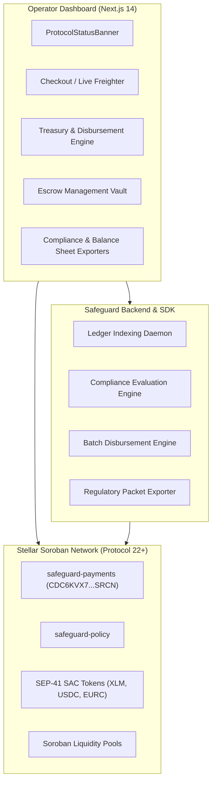

# Safeguard Operator & Treasury Console

[](https://github.com/Safeguard-Inc/safeguard-dashboard/actions/workflows/ci.yml)
[](https://safeguard-dashboard-mocha.vercel.app)
[](https://nextjs.org)
[](https://stellar.org)
[](tsconfig.json)
[](LICENSE)

**Enterprise Operator, Compliance, and Treasury Management Console for Safeguard Institutional Payments on Stellar.**

Real-time on-chain policy enforcement, Soroban escrow vault management, multi-party batch disbursement execution, sealed compliance packet exports, and continuous consensus telemetry.

**Live Production Console:** **<https://safeguard-dashboard-mocha.vercel.app>**

[](https://safeguard-docs.vercel.app/assets/video/safeguard-pitch.mp4)

---

## Visual Dashboard Overview

```text
┌────────────────────────────────────────────────────────────────────────────────────────────────────────┐
│ 🛡️ SAFEGUARD PAY | Soroban SAC Gateway                      🟢 Consensus In-Sync | Testnet Protocol 22 │
├────────────────────────────────────────────────────────────────────────────────────────────────────────┤
│ 🛑 CIRCUIT BREAKER STATUS: Normal / Operational   •   Ledger Sync Lag: 1.2s   •   Active Rules: 3      │
├────────────────────────────────────────────────────────────────────────────────────────────────────────┤
│ [ Payment Simulator ]  [ Treasury & Operations ]  [ Policy Rules ]  [ Telemetry Explorer ]  [ Escrow ] │
├────────────────────────────────────────────────┬───────────────────────────────────────────────────────┤
│ 💳 GUARDED CHECKOUT FORM                       │ 📊 ON-CHAIN TELEMETRY SNAPSHOT                        │
│ Sender: GC5MCM...ODW4 (Testnet Admin)          │ Sequence Counter: #1,842                              │
│ Recipient: GA6LW7...CVLT (Compliant Merchant)  │ Cumulative Volume: $142,500 USDC                      │
│ Amount: 50.00 XLM / USDC                       │ Storage Rent TTL: 342,120 ledgers remaining           │
│                                                ├───────────────────────────────────────────────────────┤
│ [⚡ SIMULATE EVALUATION]  [🚀 LIVE FREIGHTER]   │ ⚡ ENTERPRISE BATCH DISBURSEMENT ENGINE               │
│                                                │ Partition: 25 tx / chunk  •  Est. Fee: 0.0020 XLM     │
├────────────────────────────────────────────────┴───────────────────────────────────────────────────────┤
│ 📜 COMPLIANCE & REGULATORY EXPORT SUITE                                                                │
│ [📊 Download Audited Balance Sheet (MD/JSON)]  [📜 Export Sealed Compliance Archive Packet (SHA-256)]  │
└────────────────────────────────────────────────────────────────────────────────────────────────────────┘
```

---

## Table of Contents

- [The Safeguard Stack](#the-safeguard-stack)
- [Enterprise Console Modules](#enterprise-console-modules)
- [Interactive Scenarios & Live Proofs](#interactive-scenarios--live-proofs)
- [Architecture & Data Flow](#architecture--data-flow)
- [Getting Started & Local Development](#getting-started--local-development)
- [Testing & Quality Assurance](#testing--quality-assurance)
- [Deployment & CI/CD](#deployment--cicd)
- [Governance & Community](#governance--community)
- [License](#license)

---

## The Safeguard Stack

| Repository | What it is | Tech |
| :--- | :--- | :--- |
| [`safeguard-contracts`](https://github.com/Safeguard-Inc/safeguard-contracts) | On-chain payments gateway, escrow vault, and dynamic policy registry | Rust, Soroban SDK (Protocol 22+) |
| [`safeguard-backend`](https://github.com/Safeguard-Inc/safeguard-backend) | High-throughput indexer, simulation engine, and REST API | TypeScript, Express, Stellar SDK |
| **`safeguard-dashboard`** (this repo) | Institutional operator & compliance console | Next.js 14, React 18, Tailwind CSS |
| [**safeguard-docs**](https://safeguard-docs.vercel.app) | Technical specification, architectural guides, and API references | Static HTML / ESM |

**Verified Testnet Contracts:**
* **SafeguardPayments**: [`CDC6KVX7QT7CD3GOVGX44NQUNS7FMSZKIAXTV3TDGSXQKJRQMDZRSRCN`](https://stellar.expert/explorer/testnet/contract/CDC6KVX7QT7CD3GOVGX44NQUNS7FMSZKIAXTV3TDGSXQKJRQMDZRSRCN)
* **SafeguardPolicy**: [`CCXFDOLLLFZKAG7X6AKN2YLKET5F5X565IHZXPOAGCM7W6MJG5WKANLN`](https://stellar.expert/explorer/testnet/contract/CCXFDOLLLFZKAG7X6AKN2YLKET5F5X565IHZXPOAGCM7W6MJG5WKANLN)
* **Native XLM SAC**: `CDLZFC3SYJYDZT7K67VZ75HPJVIEUVNIXF47ZG2FB2RMQQVU2HHGCYSC`

---

## Enterprise Console Modules

### 1. Protocol Status Banner
Sticky top alert tracking emergency guardian circuit breaker states, active pause countdowns, and indexing lag relative to the Stellar network tip ledger.

### 2. Payment Simulator & Live Checkout
Dual-mode transaction dispatcher:
* **Zero-Gas Simulator Mode:** Evaluates transactions client-side against the contract's deterministic rule hierarchy with 24/24 golden parity.
* **Live Freighter Mode:** Connects to Freighter wallet to sign and submit real SEP-41 SAC token transfers directly on Stellar Testnet.

### 3. Treasury & Operations Console
* **Gateway Telemetry Snapshot:** Live sequence counters, cumulative escrow volume, active spend cap telemetry, and consensus status.
* **Soroban AMM Routing Card:** Multi-hop path estimation across Soroban liquidity pools with slippage safety bounds.
* **Multi-Currency Settlement Estimator:** Pre-computes aggregate treasury disbursement requirements across USDC, EURC, and XLM.
* **Enterprise Batch Disbursement Engine:** Automatically validates destination addresses, divides payroll into Soroban-safe execution chunks, and calculates network fees.

### 4. Escrow Vault & Arbitration Panel
Full lifecycle management of locked collateral:
* Partial release workflows (`release_escrow_partial`).
* Dispute registration and evidence submission.
* Counterparty dispute arbitration with single or bulk releases/refunds.
* Timelocked automatic refunds for expired escrows.

### 5. Regulatory Compliance & Export Suite
* **Audited Balance Sheet Statements:** Generates timestamped balance sheets with collateral asset tables in Markdown or JSON.
* **Sealed Compliance Archive Packets:** Builds cryptographically sealed archive packets with SHA-256 integrity digests for FinCEN, MiCA, or external auditor examination.

---

## Interactive Scenarios & Live Proofs

Try these scenarios directly in the [Live Console](https://safeguard-dashboard-mocha.vercel.app):

| Scenario | Preset Input | Expected Outcome | Verified On-Chain Transaction |
| :--- | :--- | :--- | :--- |
| **Direct Compliant Payment** | Merchant preset, 50 XLM | ✅ Approved, code 0 | Direct settlement ([`c762b42f…`](https://stellar.expert/explorer/testnet/tx/c762b42f818387aa584ea33d3da006f22671071ed6e182068994ea6597395e6c)) |
| **High-Value Cap Diversion** | Merchant preset, 150 XLM | 🟡 Escrowed, code 6 | Diverted to Escrow Vault #1 ([`2d832316…`](https://stellar.expert/explorer/testnet/tx/2d83231685f03b17e1a001e6c82c38453459b4f67b416ef60f9be73133026f0e)) |
| **Admin Escrow Release** | Admin releases Escrow #1 | 🚀 Released | Recipient receives escrowed funds ([`f1257dd8…`](https://stellar.expert/explorer/testnet/tx/f1257dd8e902c4dad2c00b8f71cc98999d9885e402fbd7959c4242202cef2331)) |
| **Sanctioned Revert** | Blocked preset wallet | ⛔ Blocked, code 11 | Transaction reverted fail-closed; 0 gas consumed |

---

## Architecture & Data Flow



---

## Getting Started & Local Development

### Prerequisites
* Node.js 20+ (Node 22 and 25 supported)
* npm 10+
* Freighter browser extension (for live transaction signing)

### Installation & Run

```bash
git clone https://github.com/Safeguard-Inc/safeguard-dashboard.git
cd safeguard-dashboard
npm ci

# Run test suite (192 tests across 40 test suites)
npm test

# Type checking & production build
npx tsc --noEmit
npm run build

# Start local development server on http://localhost:3000
npm run dev
```

---

## Testing & Quality Assurance

The dashboard features **192 unit tests** covering 40 test suites with zero external mocks, validating domain math, cryptographic formatting, and state machines:

```bash
npm test
```

```text
✔ 192 tests passed across 40 test suites
✔ All Next.js page data and route static builds validated
✔ Zero bundle regressions
```

---

## Deployment & CI/CD

Continuous deployment is managed through **Vercel**:
* **Live Deployment:** [https://safeguard-dashboard-mocha.vercel.app](https://safeguard-dashboard-mocha.vercel.app)
* **GitHub Actions CI:** Every push and pull request validates:
  1. `npm ci` dependencies installation
  2. `npx tsc --noEmit` strict TypeScript compilation
  3. `npm run lint` ESLint verification
  4. 270 error code catalog sync verification
  5. Next.js 14 static generation and route manifests
  6. Open-source governance file validation
  7. Live Vercel production health check

---

## Governance & Community

* **Code of Conduct:** [CODE_OF_CONDUCT.md](CODE_OF_CONDUCT.md)
* **Contributing Guidelines:** [CONTRIBUTING.md](CONTRIBUTING.md)
* **Security Policy:** [SECURITY.md](SECURITY.md)
* **Changelog:** [CHANGELOG.md](CHANGELOG.md)

---

## License

Licensed under the Apache License, Version 2.0. See [LICENSE](LICENSE) for details.
