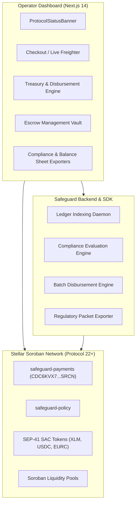

# Safeguard Dashboard

[](https://github.com/Safeguard-Inc/safeguard-dashboard/actions/workflows/ci.yml)
[](https://safeguard-dashboard-mocha.vercel.app)
[](https://nextjs.org)
[](https://stellar.org)
[](LICENSE)

**Enterprise Operator & Treasury Console for Safeguard Institutional Payments on Stellar.** Real-time policy guardrails, on-chain Soroban escrow management, multi-party atomic disbursements, automated compliance packet generation, and comprehensive consensus telemetry.

**Live Console:** **<https://safeguard-dashboard-mocha.vercel.app>**

[](https://safeguard-docs.vercel.app/assets/video/safeguard-pitch.mp4)

---

## Table of Contents

- [The Safeguard Stack](#the-safeguard-stack)
- [Enterprise Features](#enterprise-features)
- [Architecture & Verification Matrix](#architecture--verification-matrix)
- [Try These Scenarios](#try-these-scenarios)
- [Getting Started](#getting-started)
- [Testing & Quality Assurance](#testing--quality-assurance)
- [Project Structure](#project-structure)
- [Deployment](#deployment)
- [License](#license)

---

## The Safeguard Stack

| Repository | What it is | Tech |
| :--- | :--- | :--- |
| [`safeguard-contracts`](https://github.com/Safeguard-Inc/safeguard-contracts) | On-chain payments gateway, escrow vault, and dynamic policy registry | Rust, Soroban SDK (Protocol 22+) |
| [`safeguard-backend`](https://github.com/Safeguard-Inc/safeguard-backend) | High-throughput indexing daemon, compliance engine, and REST API | TypeScript, Express, Stellar SDK |
| **`safeguard-dashboard`** (this repo) | Institutional operator & compliance console | Next.js 14, React 18, Tailwind CSS |
| [`safeguard-docs`](https://github.com/Safeguard-Inc/safeguard-docs) | Technical specification, architectural guides, and API references | Static HTML / ESM |

---

## Enterprise Features

| Console Module | Operational Capabilities |
| :--- | :--- |
| **Protocol Status Banner** | Real-time global sticky alert tracking emergency guardian circuit breakers, active pause countdowns, and ledger synchronization lag. |
| **Payment Simulator & Live Checkout** | Dual-mode checkout supporting zero-gas client simulation and live on-chain submission via Freighter wallet with full SEP-41 SAC asset support. |
| **Treasury & Operations** | Comprehensive treasury management featuring the **Gateway Telemetry Snapshot**, **Soroban AMM Routing Card**, **Multi-Currency Settlement Summary**, and the **Enterprise Batch Disbursement Engine**. |
| **Policy Rules Manager** | Interactive inspection of on-chain spending caps, denylist screening rules, authority delegations, and custom per-asset thresholds. |
| **Escrow Vault & Arbitration** | Full escrow lifecycle management: multi-recipient releases, timelocked refunds, partial distributions, and dispute arbitration. |
| **Regulatory Compliance & Reporting** | Direct export of verifiable **Balance Sheet Statements** (Markdown / JSON) and cryptographically sealed **Compliance Archive Packets** (SHA-256 seal) formatted for regulatory filings. |

---

## Architecture & Verification Matrix



---

## Try These Scenarios

The console connects to the deployed Soroban contracts on Stellar Testnet ([`CDC6KVX7…SRCN`](https://stellar.expert/explorer/testnet/contract/CDC6KVX7QT7CD3GOVGX44NQUNS7FMSZKIAXTV3TDGSXQKJRQMDZRSRCN)):

| Scenario | Input | Verdict | Outcome & Telemetry |
| :--- | :--- | :--- | :--- |
| **Compliant Payment** | Compliant merchant, 50 XLM | ✅ Approved, code 0 | Direct SEP-41 transfer executed ([`c762b42f…`](https://stellar.expert/explorer/testnet/tx/c762b42f818387aa584ea33d3da006f22671071ed6e182068994ea6597395e6c)) |
| **High Value Transfer** | Compliant merchant, 150 XLM | 🟡 Escrowed, code 6 | Diverted to on-chain escrow vault ([`2d832316…`](https://stellar.expert/explorer/testnet/tx/2d83231685f03b17e1a001e6c82c38453459b4f67b416ef60f9be73133026f0e)) |
| **Denylisted Transfer** | Blocked recipient preset | ⛔ Blocked, code 11 | Transaction reverted fail-closed; 0 state change |
| **Batch Disbursement** | Multiple payroll / vendor payees | ⚡ Dispatched | Partitioned into Soroban-safe execution chunks with gas estimation |
| **Compliance Export** | Auditor packet request | 📜 Sealed Archive | Cryptographically verified SHA-256 tamper-evident export bundle |

---

## Getting Started

### Prerequisites

- Node.js 20 or later (v25 supported)
- npm 10+
- Freighter Wallet browser extension (optional for live on-chain submissions)

### Installation & Run

```bash
git clone https://github.com/Safeguard-Inc/safeguard-dashboard
cd safeguard-dashboard
npm ci
npm run dev        # http://localhost:3000
```

| Script | Purpose |
| :--- | :--- |
| `npm run dev` | Development server with hot reload |
| `npm run lint` | ESLint verification (`next/core-web-vitals`) |
| `npm run build` | Production build & static optimization |
| `npm start` | Serve production build locally |
| `npm test` | Run complete unit test suite across all domain helpers |

---

## Testing & Quality Assurance

The dashboard features **192 rigorous unit tests** covering 40 test suites with zero external mocks, validating domain math, cryptographic formatting, and state machines:

```bash
npm test
```

```text
✔ 192 tests passed across 40 test suites
✔ All Next.js page data and route static builds validated
✔ Zero bundle regressions
```

---

## Deployment

Continuous deployment is managed via **Vercel** with automated status checks on GitHub Actions:
- Push to `main` deploys to [https://safeguard-dashboard-mocha.vercel.app](https://safeguard-dashboard-mocha.vercel.app).
- CI runs linting, unit test execution, and static builds on all branches and pull requests.

---

## License

Licensed under the Apache License, Version 2.0. See [LICENSE](LICENSE) for details.
